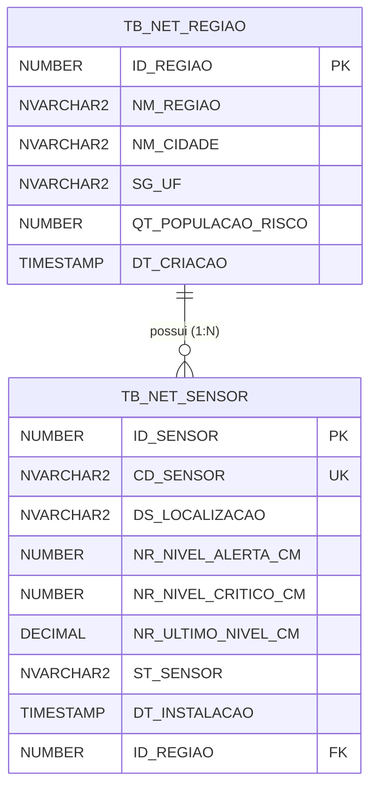

# AlagAlerta — API .NET

> Global Solution 2026/2 · **CitizenTech** · FIAP 2TDS · Advanced Business Development with .NET

## Integrantes

| Nome | RM | Turma |
|---|---|---|
| Pedro Relich | RM567933 | 2TDSPA |
| Luigi Martins | RM568381 | 2TDSPA |

**Vídeo (CRUD + tabelas no Oracle):** _cole aqui o link do YouTube_

## A solução

O **AlagAlerta** é uma CitizenTech de **alerta de enchentes** para moradores de bairros às margens de córregos.
Estações IoT medem o nível da água e a chuva. Quando o nível passa do limite daquele ponto, os moradores da
região são avisados pelo app.

Esta API em **ASP.NET Core 8** cuida do **cadastro da rede de monitoramento**: as **regiões** (bairros em área
de risco) e os **sensores** instalados em cada uma. Cada sensor guarda seus limites de alerta e de emergência e o
último nível lido; a API devolve a situação atual (`NORMAL`, `ATENCAO`, `ALERTA`, `EMERGENCIA` ou `SEM_DADOS`).
Esta API é a entrega específica de .NET. O app integrado e os containers de DevOps usam a API Java.

ODS: **11** (Cidades e comunidades sustentáveis) e **13** (Ação contra a mudança global do clima).

## Tecnologias

ASP.NET Core 8 Web API (controllers) · Entity Framework Core 8 · Oracle.EntityFrameworkCore (Oracle FIAP) · Migrations.

## Diagrama das entidades



- **Regiao 1:N Sensor**: `Regiao.Sensores` (coleção) e `Sensor.Regiao`/`Sensor.RegiaoId` (FK `FK_NET_SENSOR_REGIAO`).
- `OnDelete(Restrict)`: o Oracle não deixa apagar uma região que ainda tenha sensores, e a API devolve **409**.
- Índices únicos: código do sensor (`UK_NET_SENSOR_CODIGO`) e nome + cidade da região (`UK_NET_REGIAO_NOME_CIDADE`).
- Tabelas com prefixo `TB_NET_` para não conflitar com as tabelas da entrega de banco (PL/SQL) no mesmo schema.

## Como executar

Pré-requisitos: **.NET 8 SDK** e acesso ao Oracle da FIAP (`oracle.fiap.com.br`).

### 1. Configurar a conexão (a senha não vai para o Git)

```bash
dotnet user-secrets set "ConnectionStrings:Oracle" "User Id=RM000000;Password=SUA_SENHA;Data Source=oracle.fiap.com.br:1521/ORCL"
```

Também é possível usar a variável de ambiente `ConnectionStrings__Oracle`. O `appsettings.json` versionado
mantém a string **vazia** de propósito.

### 2. Criar as tabelas com as Migrations

```bash
dotnet tool restore
dotnet ef database update
```

A migration `CriacaoInicial` (pasta `Migrations/`) cria `TB_NET_REGIAO`, `TB_NET_SENSOR`, a FK e os índices.

### 3. Subir a API

```bash
dotnet run
```

A API sobe em **http://localhost:5080**. `GET /` devolve a descrição e as rotas.

## Como testar

O arquivo [`AlagAlerta.Api.http`](AlagAlerta.Api.http) tem todas as requisições prontas, na ordem: criar,
listar, buscar, atualizar, erros e exclusões. Ele abre no Visual Studio, no Rider ou no VS Code com a extensão
REST Client. O mesmo fluxo com `curl`:

```bash
curl -X POST http://localhost:5080/api/regioes -H "Content-Type: application/json" -d "{\"nome\":\"Jardim Pantanal\",\"cidade\":\"São Paulo\",\"uf\":\"SP\",\"populacaoRisco\":42000}"
curl -X POST http://localhost:5080/api/sensores -H "Content-Type: application/json" -d "{\"codigo\":\"SNS-PANT-01\",\"localizacao\":\"Córrego Três Pontes\",\"nivelAlertaCm\":120,\"nivelCriticoCm\":180,\"ultimoNivelCm\":128.5,\"status\":\"Ativo\",\"regiaoId\":1}"
curl http://localhost:5080/api/regioes/1
```

Conferindo no Oracle (SQL Developer):

```sql
SELECT * FROM TB_NET_REGIAO;
SELECT s.CD_SENSOR, s.NR_ULTIMO_NIVEL_CM, s.ST_SENSOR, r.NM_REGIAO
  FROM TB_NET_SENSOR s JOIN TB_NET_REGIAO r ON r.ID_REGIAO = s.ID_REGIAO;
SELECT * FROM "__EFMigrationsHistory";
```

## Rotas

| Método | Rota | Sucesso | Erros |
|---|---|---|---|
| GET | `/api/regioes` | 200 | — |
| GET | `/api/regioes/{id}` | 200 (com sensores) | 404 |
| POST | `/api/regioes` | 201 + `Location` | 400, 409 (duplicada) |
| PUT | `/api/regioes/{id}` | 204 | 400, 404, 409 |
| DELETE | `/api/regioes/{id}` | 204 | 404, 409 (tem sensores) |
| GET | `/api/sensores?regiaoId=` | 200 | — |
| GET | `/api/sensores/{id}` | 200 | 404 |
| POST | `/api/sensores` | 201 + `Location` | 400 (inclusive `regiaoId` inexistente), 409 (código repetido) |
| PUT | `/api/sensores/{id}` | 204 | 400, 404, 409 |
| DELETE | `/api/sensores/{id}` | 204 | 404 |

### Validação e erros

- **400**: Data Annotations (`[Required]`, `[StringLength]`, `[Range]`, `[RegularExpression]`) e
  `IValidatableObject` para a regra "nível crítico maior que nível de alerta". O `[ApiController]` devolve JSON
  com as mensagens por campo:

  ```json
  {"title":"One or more validation errors occurred.","status":400,
   "errors":{"Uf":["uf deve ter 2 letras maiúsculas (ex.: SP)"],"Nome":["nome é obrigatório"]}}
  ```
- **404**: `{"status":404,"mensagem":"Sensor 42 não encontrado"}`
- **409**: duplicidade ou exclusão bloqueada, no mesmo formato do 404.
- **500**: middleware `UseExceptionHandler` devolve JSON sem stack trace.

## Fluxo de uma requisição

`POST /api/sensores` → roteamento para `SensoresController.Criar` → model binding + validação automática
(`[ApiController]`) → consulta da região no `AppDbContext` → `_db.Sensores.Add` + `SaveChangesAsync()`
(o EF Core gera o `INSERT` no Oracle) → `CreatedAtAction` devolve **201** com o header `Location`.

## Estrutura

```
├── Controllers/        RegioesController, SensoresController (5 rotas cada)
├── Data/               AppDbContext (mapeamento Oracle) e factory de design-time do dotnet ef
├── Dtos/               requests com validação e responses
├── Migrations/         CriacaoInicial
├── Models/             Regiao, Sensor
├── AlagAlerta.Api.http requisições de teste
└── Program.cs
```

## Uso de IA generativa

Usamos o assistente **Claude (Anthropic)** para gerar a estrutura inicial do projeto e redigir este README.
Compilação local verificada em 17/11/2026, com destino net8.0, sem erros. A execução das migrations e do CRUD no Oracle da FIAP ainda precisa ser comprovada pela equipe.
