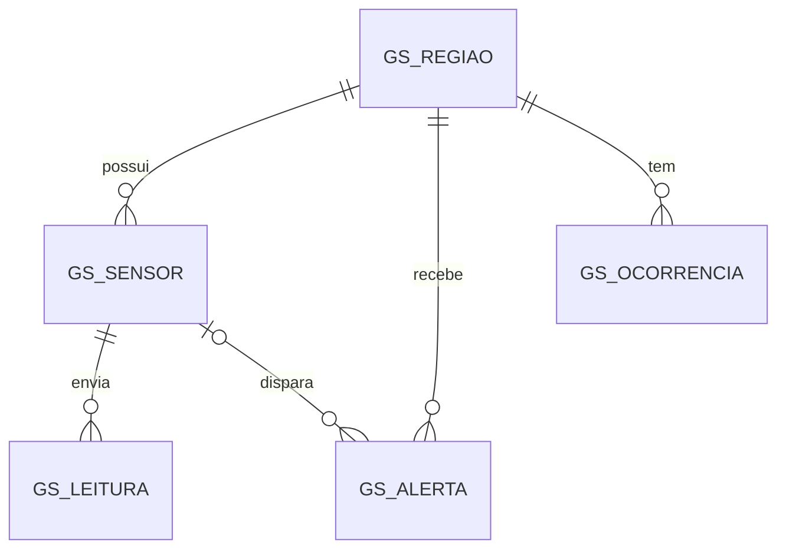

# AlagAlerta — Camada de dados em Oracle PL/SQL

> Global Solution 2026/2 · **CitizenTech** · FIAP 2TDS · Mastering Relational and Non-Relational Database

## Integrantes

| Nome | RM | Turma |
|---|---|---|
| Pedro Relich | RM567933 | 2TDSPA |
| Luigi Martins | RM568381 | 2TDSPA |

## Problema

Bairros às margens de córregos (Jardim Pantanal, Jardim Romano, Jardim Helena...) alagam todo verão, e o
morador só percebe quando a água chega à porta. O **AlagAlerta** usa sensores IoT nos córregos para medir o
nível da água e a chuva, gera **alertas** para a população da região e recebe **relatos** dos moradores.

Esta entrega implementa em **PL/SQL** a camada de processamento desses dados: classificar o risco de cada
leitura, gerar/elevar alertas, projetar quando o córrego vai transbordar e **priorizar o atendimento da Defesa Civil**.

## Modelo de dados (5 tabelas relacionadas)

| Tabela | Linhas de teste | Conteúdo |
|---|---|---|
| `GS_REGIAO` | 10 | bairros em área de risco e população exposta |
| `GS_SENSOR` | 12 | estações com limites de alerta/crítico por córrego (1 em manutenção) |
| `GS_LEITURA` | 30 | nível da água (cm), chuva (mm/h) e risco classificado |
| `GS_ALERTA` | 10 | 5 ativos e 5 encerrados (histórico) |
| `GS_OCORRENCIA` | 10 | relatos de moradores em vários status |

Restrições: PK por identity, FKs, `UNIQUE` (código do sensor; região + cidade) e `CHECK` (status, níveis
válidos, nível crítico maior que o de alerta, valores não negativos).

## Regras de negócio

1. **Classificação de risco da leitura**, com os limites de cada sensor (cada córrego transborda em uma altura):
   `EMERGENCIA` se água ≥ crítico; `ALERTA` se água ≥ alerta, ou ≥ 70% do alerta com chuva ≥ 50 mm/h;
   `ATENCAO` se água ≥ 70% do alerta ou chuva ≥ 30 mm/h; senão `NORMAL`.
2. **Alerta automático**: leitura com risco não NORMAL cria alerta na região; se já há alerta ativo, ele só é
   **elevado** (nunca rebaixado automaticamente).
3. **Sensor fora de operação** (`MANUTENCAO`/`INATIVO`) não aceita leituras.
4. **Recomendação por região** (bloco anônimo): EVACUAR / PREPARAR EVACUAÇÃO / MONITORAR / NORMAL.
5. **Projeção de transbordamento**: tendência entre as duas últimas leituras, simulada em ciclos de 30 min.
6. **Índice de prioridade** (0–120) combinando nível, gravidade do alerta, ocorrências, pessoas afetadas e
   população, em faixas P1 a P4.

## Scripts e requisitos

| Script | Requisito | O que faz |
|---|---|---|
| `01_ddl.sql` | Modelo Oracle (≥ 4 tabelas relacionadas) | cria as 5 tabelas, FKs, checks e índices (pode ser executado de novo, pois remove antes) |
| `02_carga.sql` | Dados de teste (≥ 10 linhas por tabela) | 10/12/30/10/10 linhas + `SELECT` de conferência |
| `03_bloco_anonimo_decisao.sql` | Bloco anônimo com variáveis, `SELECT INTO`, `DBMS_OUTPUT` + **IF/ELSIF/ELSE** | análise de risco e recomendação para uma região (regra 4) |
| `04_repeticao.sql` | Repetição **FOR** e **WHILE** | percorre os sensores ativos e projeta em quanto tempo cada córrego atinge o nível crítico (regra 5) |
| `05_cursor_explicito.sql` | **Cursor explícito** (`OPEN`/`FETCH`/`%NOTFOUND`/`%ROWCOUNT`/`CLOSE`) | painel de alertas ativos ordenado por gravidade |
| `06_procedures.sql` | **2 procedimentos** | `PRC_REGISTRAR_LEITURA` (operação, regras 1–3) e `PRC_PRIORIZAR_REGIOES` (consulta/processamento, regra 6) |
| `07_execucao_procedures.sql` | Evidências | 5 cenários de leitura (normal, cria alerta, eleva alerta, sensor em manutenção, sensor inexistente) e o ranking |

## Como executar

No **SQL Developer** conectado ao Oracle da FIAP (`oracle.fiap.com.br:1521/ORCL`), com o usuário do RM:

1. Abra cada arquivo **na ordem 01 → 07** e execute como script (**F5**, não F9).
2. Deixe a saída do DBMS_OUTPUT visível em **View → Dbms Output** e clique em **+** para ligar na conexão.
   Os scripts já têm `SET SERVEROUTPUT ON`.
3. No `03`, troque o valor de `v_nm_regiao` para ver os outros ramos da decisão:
   `Jardim Pantanal`/`Jardim Helena` (evacuar), `Lapa de Baixo` (preparar), `Jardim Romano` (monitorar), `Ipiranga` (normal).

## Resultados esperados

- **03**: Jardim Pantanal → `RECOMENDAÇÃO: EVACUAR` (há relato com água a 70 cm e pessoa ilhada).
- **04**: Jardim Helena (`SNS-HELE-01`) aparece como `JÁ NO NÍVEL CRÍTICO`; `SNS-PANT-01` sobe ~19,8 cm a
  cada 30 min e atinge o crítico em ~90 min; Franco da Rocha está descendo (estável); Vila Prudente sobe devagar
  e só chegaria ao crítico em ~17 h.
- **05**: 5 alertas ativos, começando pela EMERGÊNCIA no Jardim Helena.
- **07**: cenário 2 cria alerta ATENCAO no Parque Novo Mundo; cenário 3 eleva o alerta do Jardim Romano para
  EMERGENCIA; cenários 4 e 5 são recusados com `ORA-20012` e `ORA-20011`. No ranking, Jardim Helena, Jardim
  Romano e Jardim Pantanal aparecem em P1. Todas já têm alerta ativo, então a segunda execução não emite
  alertas novos.

Salvar as capturas reais de cada execução na pasta `evidencias/`. Ainda não foram produzidas neste ambiente.

## Uso de IA generativa

Usamos o assistente **Claude (Anthropic)** para gerar a primeira versão dos scripts e deste documento. A execução no Oracle da FIAP ainda precisa ser realizada e conferida pela equipe.

## Execução simplificada e conferência

O arquivo `00_executar_tudo.sql` chama os scripts 01 a 08 e tenta salvar a saída em `evidencias/execucao-oracle.log`.
Abra-o no SQL Developer e use F5, com a pasta do projeto acessível. O script 01 recria as cinco tabelas GS_* da entrega, apagando os dados anteriores delas.
O script 08 confere contagens, situação das procedures, erros de compilação e chaves estrangeiras.
Se o SPOOL não conseguir criar o log, ajuste seu caminho para uma pasta existente com permissão de escrita.
Confira que as cinco tabelas têm pelo menos dez linhas e que as duas procedures estão VALID, sem linhas em USER_ERRORS.
O log complementa os prints exigidos; não substitui as capturas.
