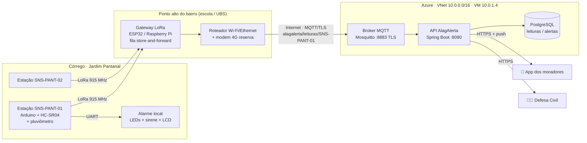

# AlagAlerta — Protótipo IoT e proposta de rede

> Global Solution 2026/2 · **CitizenTech** · FIAP 2TDS · Disruptive Architectures: IoT, IoB & Generative IA

## Integrantes

| Nome | RM |
|---|---|
| _Nome completo_ | RM00000 |
| _Nome completo_ | RM00000 |
| _Nome completo_ | RM00000 |

**Simulação no Wokwi:** _cole o link do projeto salvo_ · **Vídeo:** _link (opcional)_

## 1. Problema e proposta CitizenTech

Em bairros às margens de córregos, como Jardim Pantanal, Jardim Romano e Jardim Helena (SP), a enchente
chega em minutos e o morador só percebe quando a água entra em casa. Os alertas oficiais são regionais
(por exemplo, "chuva forte na zona leste") e não dizem **qual córrego** está subindo **agora**.

O **AlagAlerta** instala estações de baixo custo embaixo de pontes e em margens de córregos. Cada estação:

1. mede o **nível da água** com um sensor ultrassônico e a **chuva** com um pluviômetro;
2. classifica o risco **na própria estação** e aciona um **alarme local** (LEDs, sirene, display) que funciona
   mesmo sem internet;
3. envia a leitura por rede ao **gateway** do bairro, que repassa à **API AlagAlerta**. A API gera o alerta da
   região e notifica os moradores no app.

Cidadão beneficiado: famílias em área de risco de inundação. ODS **11** (meta 11.5) e **13** (meta 13.1).

## 2. Protótipo (Arduino Uno)

| Componente | Função | Pino |
|---|---|---|
| Arduino Uno R3 | processamento e regra de risco | — |
| HC-SR04 (ultrassônico) | distância até a superfície da água → nível = altura de instalação − distância | TRIG D9, ECHO D10 |
| Potenciômetro 10 kΩ | **simula** o pluviômetro (0–100 mm/h) | A0 |
| Pluviômetro de báscula (campo) | 0,2794 mm por basculada, contado por interrupção (`#define USAR_PLUVIOMETRO`) | D2 (INT0) |
| LCD 16x2 I2C (0x27) | nível, variação, risco e chuva no local | SDA A4, SCL A5 |
| 4 LEDs + resistores 220 Ω | verde NORMAL, amarelo ATENÇÃO, laranja ALERTA, vermelho EMERGÊNCIA | D4–D7 |
| Buzzer | bipe em ALERTA, sirene em EMERGÊNCIA | D8 |

Arquivos em [`estacao/`](estacao): `estacao.ino` (código), `diagram.json` (circuito Wokwi) e `libraries.txt`.

### Lógica embarcada

- Leitura a cada 5 s no protótipo (60 s no campo), com **média móvel de 5 amostras** para filtrar ondas e ruído.
- **Mesma regra de risco da API** (limites do ponto `SNS-PANT-01`: alerta 120 cm, crítico 180 cm):
  `EMERGENCIA` se nível ≥ 180; `ALERTA` se nível ≥ 120, ou ≥ 84 cm (70%) com chuva ≥ 50 mm/h;
  `ATENCAO` se nível ≥ 84 cm ou chuva ≥ 30 mm/h; senão `NORMAL`.
- Calcula a **variação** em relação à leitura anterior (velocidade de subida).
- Falha do sensor (sem eco) é detectada e mostrada no LCD em vez de enviar dado falso.
- Saída serial, uma linha JSON por leitura, consumida pelo gateway:

```json
{"codigoSensor":"SNS-PANT-01","seq":12,"nivelAguaCm":128.0,"chuvaMmHora":47.3,"variacaoCm":4.2,"riscoLocal":"ALERTA"}
```

### Como executar a simulação

1. Acesse https://wokwi.com/projects/new/arduino-uno.
2. Substitua `sketch.ino` pelo conteúdo de `estacao/estacao.ino` e `diagram.json` pelo de `estacao/diagram.json`.
3. Em **Library Manager**, adicione **LiquidCrystal I2C**.
4. Clique em ▶. Para testar, clique no **HC-SR04** e mova a distância (120 cm → nível 130 = ALERTA;
   60 cm → nível 190 = EMERGÊNCIA; 200 cm → nível 50 = NORMAL). Gire o **potenciômetro** para simular chuva.

## 3. Proposta de comunicação em rede

### Dispositivos e meios

| Camada | Dispositivo | Meio / protocolo | Por quê |
|---|---|---|---|
| Sensoriamento | Estação (Arduino + HC-SR04 + pluviômetro + LoRa SX1276) | **LoRa 915 MHz** (faixa ISM liberada pela Anatel), alcance 2–5 km em área urbana | córregos ficam em pontos sem Wi-Fi; LoRa tem longo alcance e baixo consumo (bateria + painel solar) |
| Concentração | **Gateway do bairro**: ESP32 + LoRa ou Raspberry Pi + concentrador LoRa, em local alto (escola, UBS, base da Defesa Civil) | recebe LoRa e sai por **Wi-Fi/Ethernet**, com **modem 4G** como link reserva | um gateway atende várias estações; dois links evitam ponto único de falha durante a tempestade |
| Transporte | Roteador do local / rede móvel 4G | Internet, **MQTT sobre TLS (porta 8883)** | MQTT é leve, funciona com conexões instáveis (QoS 1, sessão persistente) |
| Nuvem | **Broker MQTT** (Mosquitto) + **API AlagAlerta** (Spring Boot) + PostgreSQL na VM Azure | rede virtual Azure `10.0.0.0/16`, subnet `10.0.1.0/24`; NSG libera só 8883 (MQTT/TLS), 8080 (API) e 22 (SSH) | o mesmo ambiente da entrega de DevOps |
| Usuário | App Mobile dos moradores, painel da Defesa Civil | **HTTPS/REST + JWT** e notificação push | o morador recebe o alerta do seu bairro |

### Caminho dos dados



1. A estação mede, filtra, classifica e **aciona o alarme local na hora**, sem depender de rede.
2. Envia a leitura em JSON por **LoRa** (no protótipo, pela **serial USB**) para o gateway.
3. O gateway publica no tópico MQTT `alagalerta/leituras/{codigoSensor}` (QoS 1). Se a internet cair, ele
   **guarda em fila** e reenvia depois com o horário original da medição.
4. O serviço da API consome a mensagem e faz o mesmo processamento de `POST /api/leituras`: grava a leitura,
   classifica e cria ou eleva o alerta da região.
5. O app dos moradores daquela região recebe o alerta. A Defesa Civil vê o painel e as ocorrências.

### Gateway (protótipo funcional)

[`gateway/gateway.mjs`](gateway/gateway.mjs) implementa o passo 3/4 em Node.js 18+: lê as linhas JSON da
estação, autentica na API com JWT (usuário de serviço `gateway@alagalerta.com`, papel AGENTE), envia
`POST /api/leituras` e mantém **fila com reenvio** quando a API está fora do ar. No protótipo, o envio é HTTP
direto, sem o broker MQTT.

```bash
# com a API Java rodando em localhost:8080
cd gateway
GATEWAY_SENHA=Teste@2026 node gateway.mjs --simular        # cenário de enchente simulado
GATEWAY_SENHA=Teste@2026 node gateway.mjs < leituras.jsonl # linhas copiadas do monitor serial do Wokwi
```

## 4. Testes e evidências

| # | Cenário | Entrada | Esperado | Resultado |
|---|---|---|---|---|
| 1 | Seca | distância 200 cm, chuva 5 mm/h | nível 50 cm, NORMAL, LED verde | _registrar_ |
| 2 | Chuva forte, córrego baixo | distância 200 cm, chuva 35 mm/h | ATENÇÃO, LED amarelo | _registrar_ |
| 3 | Pré-alerta | distância 160 cm (nível 90), chuva 10 | ATENÇÃO (≥ 70% do alerta) | _registrar_ |
| 4 | Antecipação por chuva | nível 90, chuva 55 mm/h | ALERTA antes de atingir 120 cm | _registrar_ |
| 5 | Limite do alerta | distância 130 cm (nível ≈ 120) | ALERTA quando ≥ 120,0 e ATENÇÃO quando 119,9 | ✅ verificado no Wokwi (ver abaixo) |
| 6 | Emergência | distância 60 cm (nível 190) | EMERGÊNCIA, LED vermelho, sirene | _registrar_ |
| 7 | Sensor sem eco | desconectar ECHO | "FALHA SENSOR" no LCD, nada enviado | _registrar_ |
| 8 | Ponta a ponta | `gateway.mjs --simular` | API registra 8 leituras e eleva o alerta do Jardim Pantanal para EMERGÊNCIA | ✅ verificado |
| 9 | Dado inválido | linha não-JSON / sensor inexistente | gateway ignora / API devolve 404 e o gateway descarta | ✅ verificado |

Saída do monitor serial no teste 5 (média móvel estabilizando em torno do limite de 120 cm):

```
# AlagAlerta estacao iniciada
{"codigoSensor":"SNS-PANT-01","seq":0,"nivelAguaCm":120.5,"chuvaMmHora":0.0,"variacaoCm":0.0,"riscoLocal":"ALERTA"}
{"codigoSensor":"SNS-PANT-01","seq":1,"nivelAguaCm":120.0,"chuvaMmHora":0.0,"variacaoCm":-0.5,"riscoLocal":"ALERTA"}
{"codigoSensor":"SNS-PANT-01","seq":2,"nivelAguaCm":119.9,"chuvaMmHora":0.0,"variacaoCm":-0.2,"riscoLocal":"ATENCAO"}
```

Saída real dos testes 8 e 9:

```
[gateway] autenticado como gateway@alagalerta.com
[gateway] SNS-PANT-01 60 cm / 5 mm/h => NORMAL
[gateway] SNS-PANT-01 95 cm / 34 mm/h => ATENCAO
[gateway] SNS-PANT-01 128 cm / 47 mm/h => ALERTA
[gateway] SNS-PANT-01 185 cm / 64 mm/h => EMERGENCIA -> ALERTA #1
[gateway] linha ignorada (Unexpected token 'l', "lixo" is not valid JSON): lixo
[gateway] leitura recusada (HTTP 404): Sensor não encontrado(a): SNS-XXX
```

As capturas da simulação ficam em `evidencias/`.

### Limitações e próximos passos

- O HC-SR04 sofre com espuma, galhos e chuva intensa no feixe. No campo, o indicado é um **sensor ultrassônico
  à prova d'água (JSN-SR04T)** ou um **radar de nível**, sempre com a média móvel.
- O potenciômetro só **simula** a chuva. A leitura real usa o pluviômetro de báscula (código já preparado).
- O Arduino Uno não tem rádio. A versão de campo troca o envio serial por um módulo **LoRa SX1276** ou usa um
  **ESP32**.
- Energia: a estação precisa de bateria e painel solar, porque a rede elétrica costuma cair justamente na enchente.
- Calibração: a altura de instalação e os limites de alerta/crítico de cada ponto devem ser definidos com a
  Defesa Civil a partir do histórico de transbordamento.

## 5. Justificativa das escolhas

- **Ultrassônico, e não sensor de contato**: fica fora da água, não corrói e não é arrastado pela correnteza.
- **Regra de risco na borda (edge)**: o alarme local funciona mesmo com rede ou nuvem fora do ar, o cenário
  mais provável durante um temporal.
- **Mesma regra da API**: o que a sirene indica e o que o app mostra nunca divergem.
- **LoRa + MQTT**: longo alcance e baixo consumo no campo, protocolo leve e tolerante a quedas até a nuvem.
- **Média móvel e variação**: evitam falso alarme por onda e mostram a velocidade de subida, que é o que define
  o tempo para evacuar.

## Uso de IA generativa

Usamos o assistente **Claude (Anthropic)** para gerar a primeira versão do código, do circuito e deste documento.
O grupo montou, executou e testou a simulação e é capaz de explicar cada componente.
