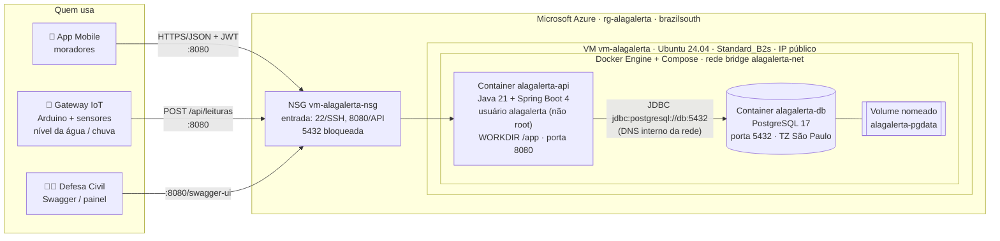

# AlagAlerta — DevOps Tools & Cloud Computing

> Global Solution 2026/2 · **CitizenTech** · FIAP 2TDS

## Integrantes

| Nome | RM | Turma |
|---|---|---|
| Pedro Relich | RM567933 | 2TDSPA |
| Luigi Martins | RM568381 | 2TDSPA |

**Vídeo (YouTube não listado, 720p+):** _cole o link aqui_

## A solução

**AlagAlerta** é uma CitizenTech de alerta de enchentes. Sensores IoT nos córregos enviam o nível da água e a
chuva para a **API Java (Spring Boot)**, que classifica o risco, gera alertas para os moradores da região e
recebe relatos de alagamento pelo app. Nesta entrega a API e o banco **PostgreSQL** rodam em **dois containers
integrados** em uma **VM Linux na Azure** provisionada com **Azure CLI**.

## Arquitetura macro



| Componente | Detalhe |
|---|---|
| Grupo de recursos | `rg-alagalerta` (região `brazilsouth`, configurável) |
| VM | `vm-alagalerta`, Ubuntu 24.04 LTS, `Standard_B2s` (2 vCPU, 4 GB), disco de 30 GB, login por chave SSH |
| NSG | regras de entrada: 22 (SSH) e 8080 (API). A 5432 **não** é exposta à internet |
| Container `alagalerta-api` | imagem multi-stage (Maven → JRE 21 Alpine), usuário `alagalerta`, `WORKDIR /app`, `ENV` de perfil/porta/JVM, `EXPOSE 8080`, healthcheck em `/actuator/health` |
| Container `alagalerta-db` | `postgres:17-alpine`, variáveis `POSTGRES_*`, porta 5432 publicada só em `127.0.0.1` (a API usa a rede interna), healthcheck `pg_isready` |
| Volume | `alagalerta-pgdata` (nomeado) em `/var/lib/postgresql/data`: os dados sobrevivem a `docker compose down` |
| Rede | `alagalerta-net` (bridge): a API acessa o banco pelo nome do serviço `db` |
| Tabelas | `TB_REGIAO`, `TB_SENSOR`, `TB_LEITURA`, `TB_ALERTA`, `TB_OCORRENCIA`, `TB_USUARIO` (relacionadas por FK) |

## Arquivos

```
├── Dockerfile                  imagem da API (multi-stage, não-root)
├── docker-compose.yml          api + db + rede + volume + portas + env + depends_on
├── .env.example                modelo das variáveis (o .env real não é versionado)
└── infra/azure/
    ├── variaveis.sh            nomes, região e tamanho da VM
    ├── 01-criar-vm.sh          grupo de recursos, VM, NSG/porta 8080 e instalação do Docker (Azure CLI)
    ├── 02-instalar-docker.sh   Docker Engine + Compose (executado na VM via az vm run-command)
    └── 03-remover-tudo.sh      apaga o grupo de recursos ao final
```

## How To — do zero até a API no ar

### 1. Provisionar a VM com Azure CLI

No **Azure Cloud Shell (Bash)** ou em um terminal com Azure CLI e `az login` feito:

```bash
git clone https://github.com/iMartiinsS/alagalerta-api.git
cd alagalerta-api
bash infra/azure/01-criar-vm.sh
```

O script cria o grupo de recursos, a VM com IP público, nome DNS (`alagalerta-rm568381.<regiao>.cloudapp.azure.com`) e chave SSH, libera a porta 8080 no NSG e instala o
Docker + Compose na VM (`az vm run-command`). No final ele mostra o IP público.

Os comandos executados, um a um (é o mesmo conteúdo do script):

```bash
az group create --name rg-alagalerta --location brazilsouth
az vm create --resource-group rg-alagalerta --name vm-alagalerta --image Ubuntu2404 --size Standard_B2s \
  --admin-username azureuser --generate-ssh-keys --public-ip-sku Standard \
  --public-ip-address-dns-name alagalerta-rm568381 \
  --nsg vm-alagalerta-nsg --nsg-rule SSH --os-disk-size-gb 30
az vm open-port --resource-group rg-alagalerta --name vm-alagalerta --port 8080 --priority 1010
az vm run-command invoke --resource-group rg-alagalerta --name vm-alagalerta \
  --command-id RunShellScript --scripts @infra/azure/02-instalar-docker.sh --parameters azureuser
az vm show -d -g rg-alagalerta -n vm-alagalerta --query publicIps -o tsv
```

### 2. Deploy na VM

```bash
ssh azureuser@<IP_PUBLICO>

git clone https://github.com/iMartiinsS/alagalerta-api.git
cd alagalerta-api
cp .env.example .env
nano .env                      # troque POSTGRES_PASSWORD e JWT_SECRET (openssl rand -base64 48)

docker compose up -d --build   # sobe em background
docker compose ps              # os dois containers devem ficar "healthy"
```

### 3. Testar

- Swagger: `http://<IP_PUBLICO>:8080/swagger-ui.html`
- Health: `http://<IP_PUBLICO>:8080/actuator/health`

```bash
IP=<IP_PUBLICO>
# login (usuário de teste do seed)
TOKEN=$(curl -s -X POST http://$IP:8080/auth/login -H "Content-Type: application/json" \
  -d '{"email":"admin@alagalerta.com","senha":"Teste@2026"}' | sed -E 's/.*"token":"([^"]+)".*/\1/')

# CREATE
curl -s -X POST http://$IP:8080/api/regioes -H "Authorization: Bearer $TOKEN" -H "Content-Type: application/json" \
  -d '{"nome":"Vila Azure","cidade":"São Paulo","uf":"SP","populacaoRisco":5000}'
# READ
curl -s http://$IP:8080/api/regioes?cidade=S%C3%A3o%20Paulo -H "Authorization: Bearer $TOKEN"
# UPDATE (troque {id} pelo id retornado no CREATE)
curl -s -X PUT http://$IP:8080/api/regioes/{id} -H "Authorization: Bearer $TOKEN" -H "Content-Type: application/json" \
  -d '{"nome":"Vila Azure","cidade":"São Paulo","uf":"SP","populacaoRisco":7500}'
# CREATE na tabela relacionada (leitura de sensor gera alerta)
curl -s -X POST http://$IP:8080/api/leituras -H "Authorization: Bearer $TOKEN" -H "Content-Type: application/json" \
  -d '{"codigoSensor":"SNS-ROMA-01","nivelAguaCm":170,"chuvaMmHora":60}'
# DELETE
curl -s -o /dev/null -w "%{http_code}\n" -X DELETE http://$IP:8080/api/regioes/{id} -H "Authorization: Bearer $TOKEN"
```

### 4. Evidências técnicas (roteiro do vídeo)

```bash
docker compose ps                                   # containers em execução (background)
docker images | grep alagalerta                     # imagem construída
docker logs alagalerta-api --tail 30                # logs da API
docker logs alagalerta-db --tail 20                 # logs do banco
docker exec -it alagalerta-api sh -c 'whoami && id && pwd && ls -la'   # usuário não-root, WORKDIR /app
docker exec alagalerta-api env | grep -E 'SPRING_PROFILES_ACTIVE|DB_URL|PORT'   # variáveis de ambiente
docker volume inspect alagalerta-pgdata             # volume nomeado
docker network inspect alagalerta-net               # os dois containers na mesma rede

# SELECT direto no banco
docker exec -it alagalerta-db psql -U alagalerta -d alagalerta -c '\dt'
docker exec -it alagalerta-db psql -U alagalerta -d alagalerta \
  -c "SELECT r.nome, s.codigo, l.nivel_agua_cm, l.nivel_risco, l.data_hora
        FROM tb_leitura l JOIN tb_sensor s ON s.id = l.sensor_id JOIN tb_regiao r ON r.id = s.regiao_id
       ORDER BY l.data_hora DESC LIMIT 10;"

# persistência: derruba e sobe de novo — os dados continuam
docker compose down
docker compose up -d
docker exec -it alagalerta-db psql -U alagalerta -d alagalerta -c "SELECT COUNT(*) FROM tb_regiao;"
```

### 5. Remover os recursos

```bash
bash infra/azure/03-remover-tudo.sh
```

## Checklist dos requisitos

Os arquivos e comandos abaixo estão preparados. A execução na Azure, os containers e a persistência ainda precisam ser comprovados na VM.

- [ ] VM Azure provisionada por Azure CLI, com os comandos versionados em `infra/azure/`
- [ ] Docker, Dockerfile e Docker Compose dentro da VM
- [x] Container da aplicação: CRUD completo, tabelas relacionadas, persistência, usuário não privilegiado,
      `WORKDIR`, variável de ambiente, porta exposta
- [x] Container do banco: volume nomeado, variáveis de ambiente, porta, tabelas relacionadas, persistência
- [x] `docker-compose.yml` com aplicação, banco, network, volume, portas, variáveis e `depends_on` (com healthcheck)
- [x] Arquitetura macro específica da solução
- [ ] Execução em background (`-d`), logs, `exec`, `SELECT` no banco
